<div align="center">


# Tallymark

**Catch the requirement nobody extracted, before your First Article report gets rejected.**

An AI harness that reads an engineering drawing on its own, greys out everything the
Bill of Characteristics already covers, and lights up only what no row covers.
The quality engineer checks 4 items instead of hunting through 200.

[](https://radhires-tallymark.vercel.app/)
&nbsp;
[](docs/Tallymark-Design-Document.pdf)
&nbsp;

&nbsp;

&nbsp;


### [▶ Try it live: radhires-tallymark.vercel.app](https://radhires-tallymark.vercel.app/)

<sub>Click <b>Use sample drawing</b>, then <b>Run check</b>. No key needed; bring your own to switch on the AI check.</sub>

**[📄 Read the 3-page design document](docs/Tallymark-Design-Document.pdf)** ·
[Quick start](#-quick-start) ·
[Try your own files](#-try-your-own-files) ·
[How it works](#-how-it-works) ·
[Is it any good?](#-is-it-any-good) ·
[Real vs stubbed](#-whats-real-and-whats-stubbed)

<sub>Built for the RadHires Harness Challenge. Tallymark is a fictional demo brand.</sub>

</div>

---

## 🎯 The problem in one minute

Before a machine shop ships the first production part to an aerospace customer, the AS9102
standard requires a **First Article Inspection Report**. The customer sends the drawing; the
supplier lists every requirement on it in a **Bill of Characteristics** (BoC, one row per
callout or note), measures the first part against every row, and submits the report.

**If one requirement on the drawing has no row, that feature is never measured and the whole
report can be rejected.** AI tools now draft the BoC faster, but somebody still has to prove
nothing was missed, by eye, across hundreds of callouts.

Tallymark is that proof step, automated and explainable:

| | |
| --- | --- |
| **You load** | the drawing (PDF / TIFF) and the BoC built from it (CSV / Excel, including the official AS9102 Form 3 layout) |
| **You get** | a short list of flags on the drawing: <kbd>U</kbd> a requirement with no row, <kbd>P</kbd> a "4X" callout whose row lists fewer places |
| **You decide** | Confirm miss, Excluded by customer rule, or Dismiss (keys <kbd>C</kbd> <kbd>E</kbd> <kbd>D</kbd>), then export the exceptions as CSV |

---

## 👀 See it

<p align="center">
  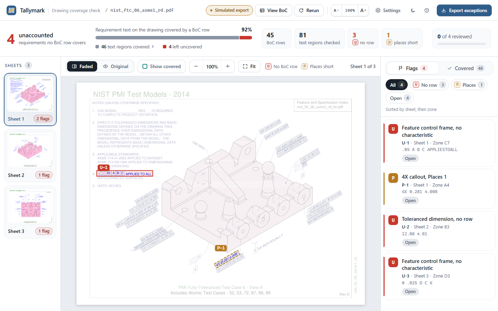
</p>

<table>
  <tr>
    <td width="50%">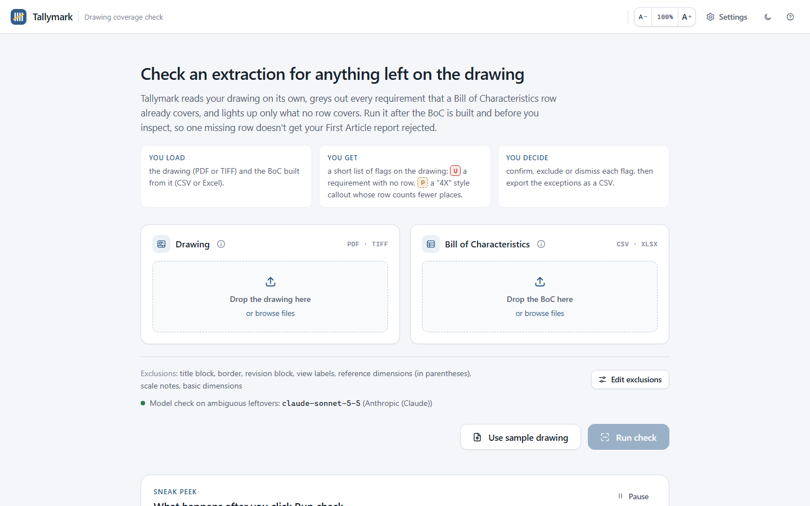<br><sub><b>Start:</b> what to load, what you get, an animated preview of a run</sub></td>
    <td width="50%">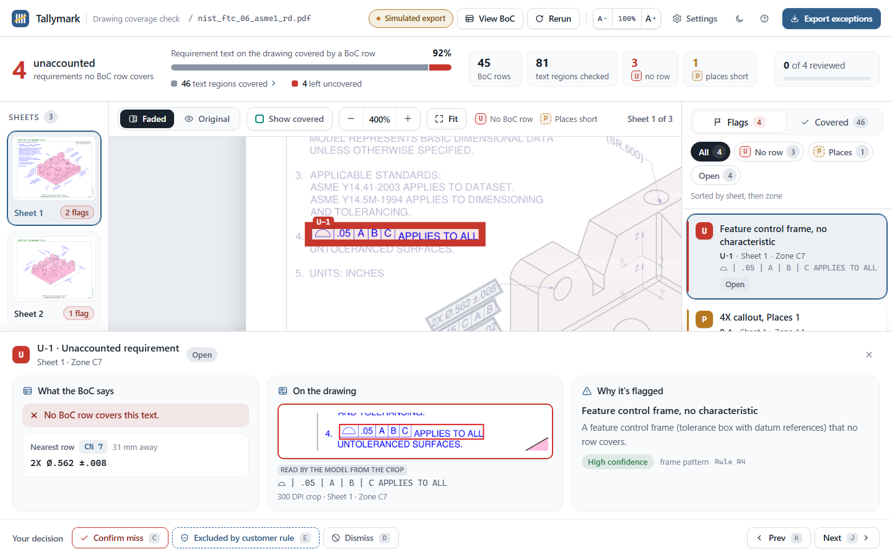<br><sub><b>Flag detail:</b> what the BoC says, what's on the drawing, why it's flagged</sub></td>
  </tr>
  <tr>
    <td>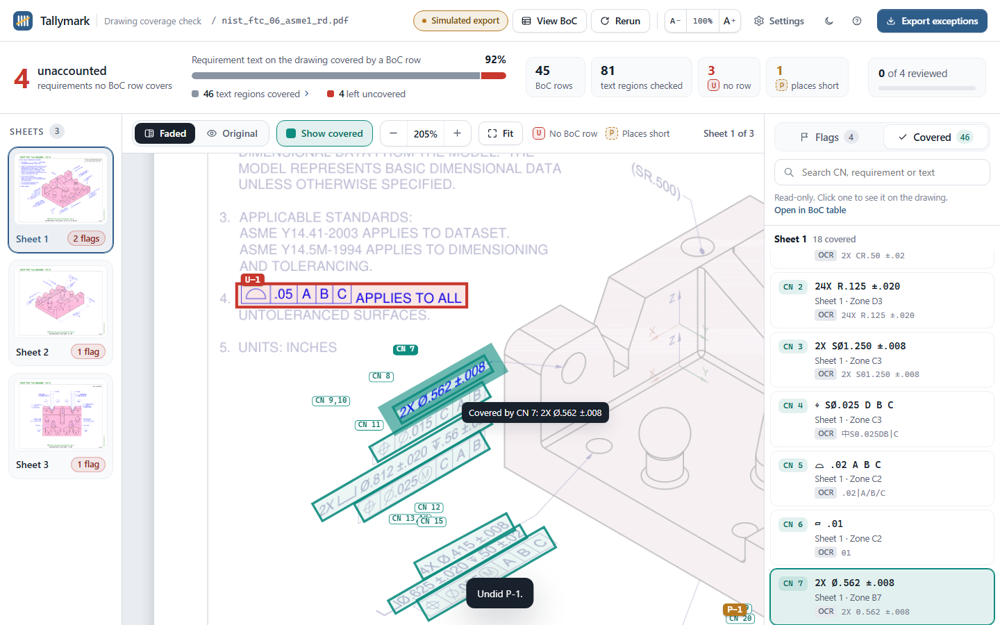<br><sub><b>Covered:</b> every region a BoC row already accounts for, one click away</sub></td>
    <td>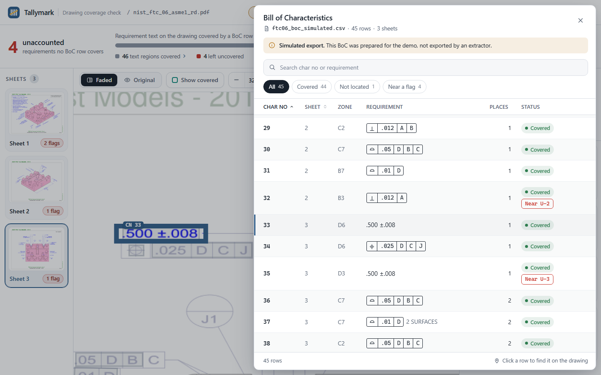<br><sub><b>View BoC:</b> the uploaded table with per-row status; click a row to jump to it</sub></td>
  </tr>
  <tr>
    <td>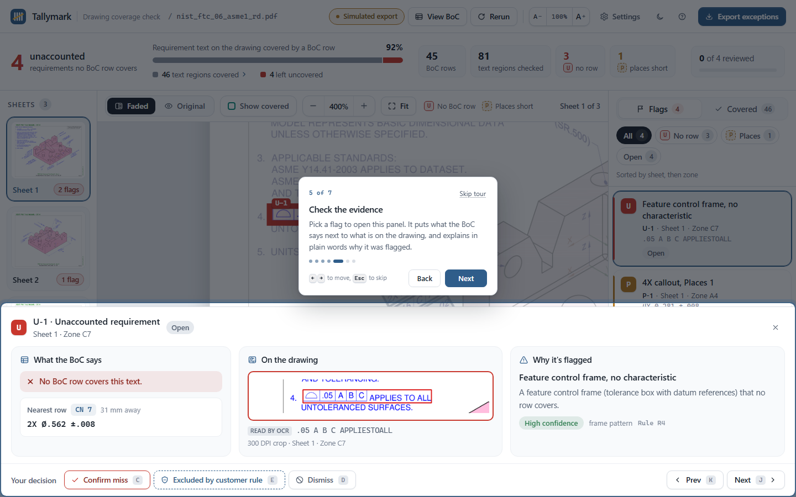<br><sub><b>Guided tour</b> on first run, replayable from Help</sub></td>
    <td>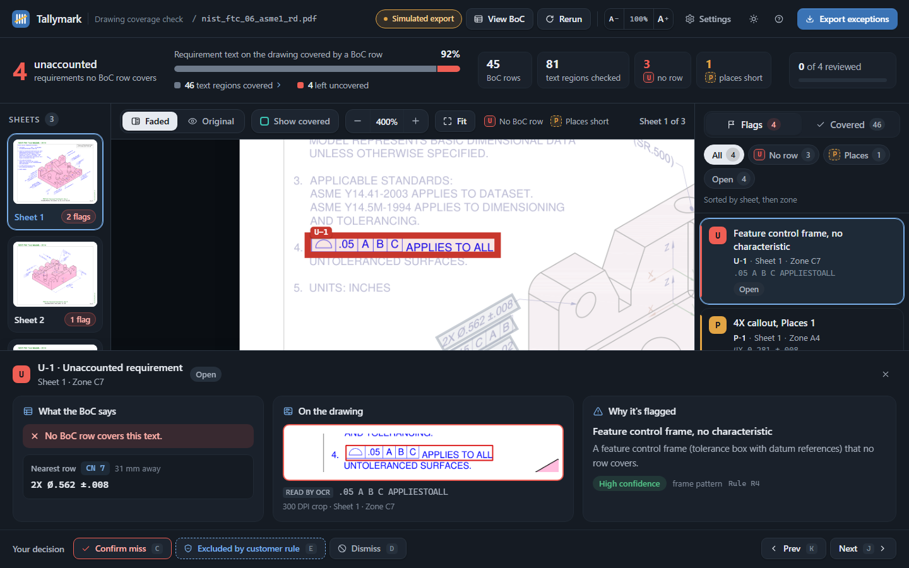<br><sub><b>Dark theme</b> on request (light by default)</sub></td>
  </tr>
  <tr>
    <td>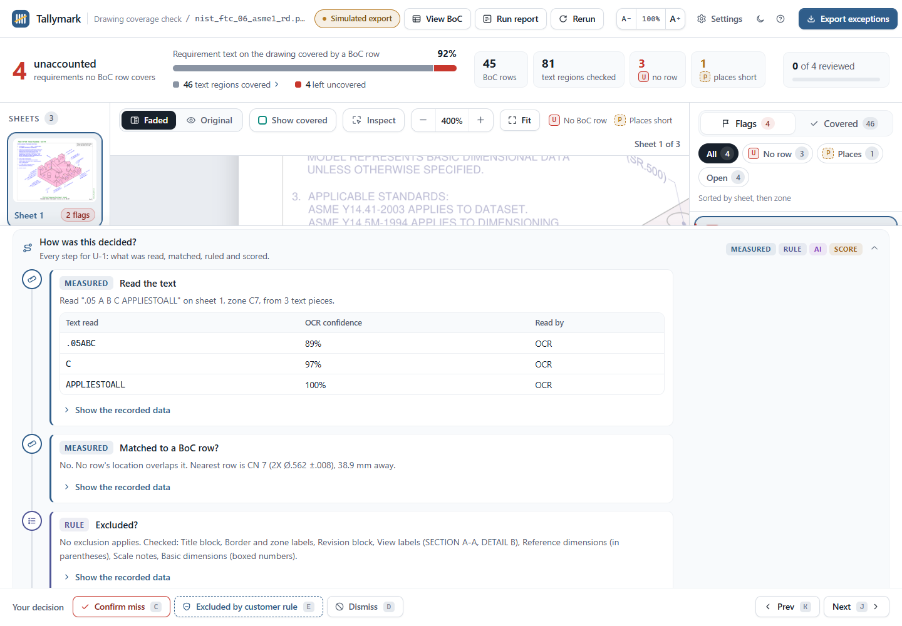<br><sub><b>How was this decided?</b> every step behind a flag, rule and AI clearly labelled</sub></td>
    <td>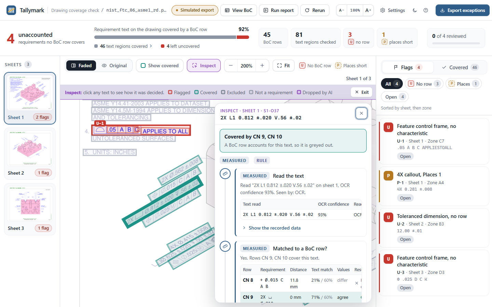<br><sub><b>Inspect:</b> click any text to see why it was or wasn't flagged</sub></td>
  </tr>
  <tr>
    <td>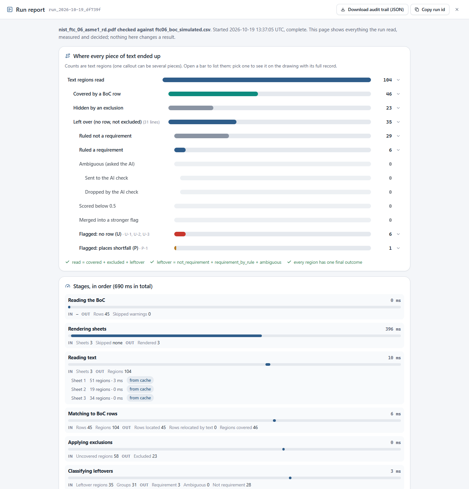<br><sub><b>Run report:</b> funnel, stage timings, every AI call, audit trail download</sub></td>
    <td>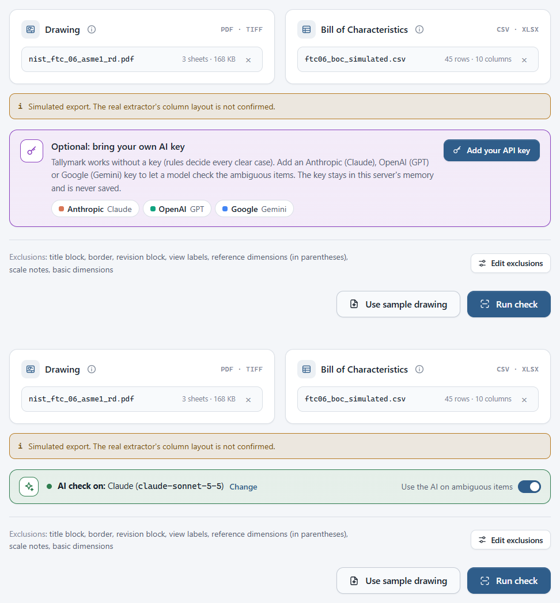<br><sub><b>Bring your own key:</b> kept in your browser tab, never stored on the server</sub></td>
  </tr>
</table>

---

## 🚀 Quick start

```bash
git clone https://github.com/PedroHang/radhires-tallymark.git
cd radhires-tallymark
python -m venv .venv
.venv/Scripts/python -m pip install -r requirements.txt     # macOS / Linux: .venv/bin/python
.venv/Scripts/python -m uvicorn app.main:app --port 8031
```

Open **http://localhost:8031**, click **Use sample drawing**, then **Run check**.

- The first run reads every sheet with OCR (roughly 10 to 30 s per sheet on a laptop CPU). Results
  are cached per drawing, so re-runs take about a second.
- **No API key is needed** to try it: rules decide every confident flag. Add a key to switch on the
  AI check for ambiguous items (see [Model providers](#-model-providers)).
- Want your own files? A ready-made pair lives in [`samples/`](samples): the public NIST FTC-06
  drawing and a BoC with four planted misses.

### 🧪 Try your own files

Five ready-to-test pairs live in [`samples/pairs/`](samples/pairs): a public NIST test drawing, a
BoC (AS9102 Form 3 `.xlsx` or CSV, with and without coordinates, one to three sheets) and a short
answer key each. One pair is complete (expect **0 flags**); the others have 3 or 4 misses planted on
purpose (deleted rows, a lowered places count). The BoCs are synthetic, built for testing.

- In the app: click **Get 5 sample pairs to test** under **Use sample drawing**, then **Load into
  Tallymark** on any pair (or download its files).
- Or download [all five as one zip](https://github.com/PedroHang/radhires-tallymark/raw/main/samples/pairs/tallymark-sample-pairs.zip)
  (0.5 MB) and drop the files in yourself.
- Leave **Use the AI** off, run the check and compare with the pair's `ANSWER-KEY.md`. Every
  expected result was produced by the real pipeline, rules only.

<p align="center">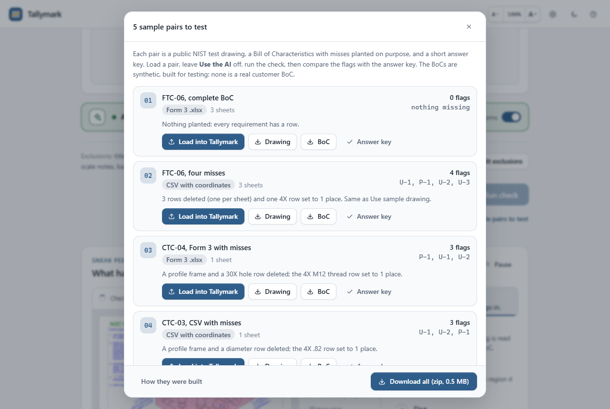</p>

---

## 🧠 How it works

Most of the job is a deterministic cross-check, so plain code does it. A vision model is used
only for the small, genuinely ambiguous residue, behind one narrow contract.

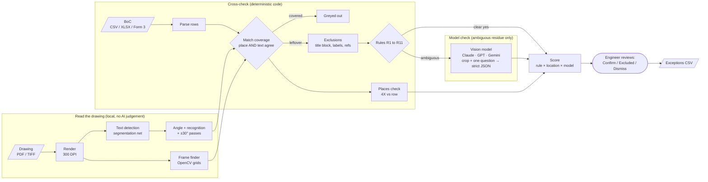

| Stage | What happens | Code |
| --- | --- | --- |
| **Render** | Pages rendered at 300 DPI (work) and 150 DPI (view) | `app/pipeline/regions.py` |
| **Read** | RapidOCR (PaddleOCR models on ONNX): a segmentation-style text detector, an angle classifier and a recogniser, plus ±30° passes for isometric callouts and the PDF text layer. OpenCV finds tolerance frames by their grid shape | `regions.py` |
| **Match** | A row covers a region only if its location **and** its text agree, so a neighbouring callout can't hide the one real miss. Rows without coordinates are placed by fuzzy text match | `coverage.py` |
| **Exclude** | Title block, border, revision tag, view labels, reference dimensions, scale notes, custom regex | `exclusions.py` |
| **Classify** | Readable rules R1 to R11 (tolerance, frame, size callout, numbered note, spec, finish…). Only ambiguous leftovers go to the model | `classify.py`, `llm.py` |
| **Places** | A "4X" callout covered by a row whose Places is lower becomes a <kbd>P</kbd> flag | `run.py` |
| **Score** | `score = base(rule) × locate_factor × llm_factor`; flag ≥ 0.5, High ≥ 0.8, Medium ≥ 0.6, each with its reason | `run.py` |

### The model contract (and why it is not an agent)

The model gets **no tools and no memory**. The harness exposes exactly one capability:
*look at this crop, with the region outlined in red, and answer one fixed question in a strict
JSON schema* (`is_requirement`, `kind`, `transcription`, `reason`, `certainty`). It can't write to
the BoC and can't decide coverage. A "not a requirement" answer drops the flag; anything else keeps
it with a stated reason. A second call only re-types flagged text with proper symbols for display.

**Failure never breaks a run.** Bad key, 403, 404, rate limit, outage or malformed output all map to
a short error code; the run completes on rules only, a banner says why, and ambiguous items stay
visible as low-confidence flags instead of disappearing.

---

## 🔌 Model providers

The same prompts and schema run on any of three providers. **Bring your own key:** paste it on the
start screen or in **Settings** (the provider is detected from the key prefix). **Test** sends one tiny
request and says plainly whether the key and model work. Whoever runs the server can instead set a
key in a `.env` file next to this README or in the host's environment variables.

| Provider | Key looks like | Env var | Default model |
| --- | --- | --- | --- |
| Anthropic | `sk-ant-...` | `ANTHROPIC_API_KEY` | `claude-sonnet-5-5` |
| OpenAI | `sk-...` | `OPENAI_API_KEY` | `gpt-6.1-sol` |
| Google Gemini | `AIza...` / `AQ....` | `GEMINI_API_KEY` or `GOOGLE_API_KEY` | `gemini-3.8-flash` |

**Your key stays in your browser tab.** It is sent only with your own checks (`X-Tallymark-Key`), is
never stored on the server, never written to run files or the audit trail, and is forgotten when the
tab closes, so one visitor's key can never pay for another visitor's run. `UINK_PROVIDER` /
`UINK_MODEL` override the defaults. Dollar cost is shown only for models with a verified price;
others show tokens.

---

## 📏 Is it any good?

An eval harness plants misses (deleted rows, wrong "places") into public NIST test drawings and
scores the output (`python -m tools.eval` → [`eval/REPORT.md`](eval/REPORT.md)). Rules only, model off:

| | Demo drawing (tuned on) | 8 unseen drawings |
| --- | :---: | :---: |
| Planted misses found | **100%** (8/8) | **98%** (63/64) |
| Flags that were real | 100% | 34% |
| False flags per clean sheet | 0 | 2.78 (0.48 excluding ambiguous items) |
| *Without coordinates (Form 3 style):* misses found / flags real | 75% / 86% | 94% / 60% |

Honest reading: recall is strong; precision on unseen drawings is the weak spot. Most of that noise
is garbled stacked tolerances, which is exactly what the model check exists to judge, and that has
not been measured yet. The test suite covers parsing (including Form 3), matching, request shapes for
all three providers and the failure paths: `python -m pytest -q`.

---

## 🖥️ The interface

Designed for a quality engineer who knows drawings, not software, and is personally accountable for
the report. A web app rather than a chat, because the work is visual and the output is a decision
per flag.

- **Start screen:** plain explainer, an animated preview of a run, hover help on each input showing what the file looks like.
- **Results:** the drawing faded with covered regions grey and gaps lit in red; an **Original** toggle proves nothing was painted over; every flag states its rule and confidence.
- **Trust what was *not* flagged:** a **Covered** tab lists every region a BoC row accounts for, **Show covered** (<kbd>V</kbd>) outlines them on the drawing with their row number, and **View BoC** (<kbd>B</kbd>) opens the uploaded table with a status per row.
- **Review:** grouped Confirm / Exclude / Dismiss buttons (<kbd>C</kbd> <kbd>E</kbd> <kbd>D</kbd>), undo (<kbd>Ctrl</kbd>+<kbd>Z</kbd>), next/previous (<kbd>J</kbd> <kbd>K</kbd>), per-sheet progress that turns green, exceptions export (<kbd>Ctrl</kbd>+<kbd>E</kbd>).
- **See every decision:** each flag has a **How was this decided?** timeline (read → matched? → excluded? → rule → AI → score, each step labelled Measured / Rule / AI / Score, with the AI's exact request and raw answer one click away). **Inspect** mode (<kbd>I</kbd>) explains any text on the drawing, including why something was *not* flagged. The **Run report** (<kbd>R</kbd>) shows the full funnel, stage timings, every AI call and a downloadable audit trail. Items the AI drops stay visible under **Dropped by AI**, with **Restore as flag**.
- **Comfort for long sessions:** guided tour on first run (replay from Help), light theme by default with dark on request, interface size control (<kbd>Ctrl</kbd>+<kbd>Alt</kbd>+<kbd>=</kbd> / <kbd>-</kbd>), resizable side panels, notices you can dismiss.

Plain HTML, CSS and JS in [`frontend/`](frontend), no build step, served by FastAPI. The add-on
modules (guided tour, BoC viewer, layout tools, decision-trace views) are self-contained files with
standalone demo pages in [`frontend/dev/`](frontend/dev).

---

## ✅ What's real and what's stubbed

| Real | Stubbed or simulated |
| --- | --- |
| OCR pipeline, frame detection, coverage matching, exclusions, rules, scoring, places check | The BoC export format: real extractors' column layouts aren't public, so the sample uses our own schema (Form 3 sheets are also accepted) |
| Provider-agnostic model calls with structured outputs and full failure handling; live Claude calls verified end to end | Accuracy with the model and the investigator on is not yet measured by the eval |
| Review workflow, dispositions, undo, exceptions CSV export | Drawings are public NIST test parts with **planted** misses, not customer drawings |
| Eval harness, unit tests, a per-run decision trace | No user accounts; on the live demo, runs are kept only briefly |

**Known limits:** it catches what was *left out*, not values that were *misread* (12.5 typed as 125).
Text the OCR never reads cannot be flagged. It points; the engineer decides and signs.

---

## ☁️ Deployment

**Live at [radhires-tallymark.vercel.app](https://radhires-tallymark.vercel.app/)** as a single Python
function on Vercel. On a serverless host each check runs inside one request (no background work after
the response), files live in `/tmp` with an optional Vercel Blob store for durability, and the bundled
sample's OCR is precomputed so a demo run finishes in seconds. Step-by-step guide, limits and
troubleshooting: [`docs/DEPLOY.md`](docs/DEPLOY.md).

---

<details>
<summary><b>📚 API reference</b></summary>

| Method | Path | Purpose |
| --- | --- | --- |
| POST | `/uploads` | Upload a drawing or BoC (`file`, `kind`), returns an `upload_id` and validation info |
| GET | `/samples` | Bundled NIST FTC-06 drawing + simulated BoC |
| POST | `/precheck` | Sheets with no BoC rows (non-blocking warning) |
| POST | `/runs` | Start a check (files or upload ids, `exclusions`, `extra_regex`, `use_llm`, `skip_sheets`) |
| GET | `/runs/{id}` | Status, stages, stats, warnings |
| GET | `/runs/{id}/events` | Server-sent events with stage progress |
| GET | `/runs/{id}/flags` | Flags (`cls`, `disposition`, `sheet` filters) |
| PATCH | `/runs/{id}/flags/{flag_id}` | Disposition: `open`, `confirmed`, `excluded`, `dismissed` + `note` |
| GET | `/runs/{id}/rows` | Parsed BoC rows |
| GET | `/runs/{id}/sheets/{n}.png` | Rendered sheet |
| GET | `/runs/{id}/sheets/{n}/coverage.json` | Covered / excluded regions + flags for the overlay |
| GET | `/runs/{id}/flags/{flag_id}/crop.png` | Evidence crop |
| GET | `/runs/{id}/exceptions.csv` | Export (`include_dismissed`) |
| GET/PUT | `/settings`, POST `/settings/test` | Provider, model, key (memory only), connection test |
| DELETE | `/runs/{id}` | Delete a run and its files |
| GET | `/runs/{id}/trace`, `/trace/regions[/{rid}]`, `/trace/flags/{fid}`, `/trace/llm/{cid}`, `/audit.json` | Decision trace and audit trail ([`docs/TRACE.md`](docs/TRACE.md)) |
| POST | `/runs/{id}/trace/regions/{rid}/restore` | Restore an item the AI dropped as an open flag |

</details>

<details>
<summary><b>📋 BoC input format</b></summary>

CSV or XLSX. Required: `char_no`, `sheet`, `requirement`. Optional: `zone`, `char_type`,
`designator`, `places`, `results_count`, `units`, `bbox_x`, `bbox_y`, `bbox_w`, `bbox_h`
(normalized 0 to 1 page coordinates of the requirement text). Common aliases are accepted.

AS9102 **Form 3** sheets work too: the parser finds the header row under the title block, strips
the numbered field names ("5. Char. No.", "8. Requirement") and reads the sheet and zone from
"Reference Location" ("Sheet 1, zone C7").

</details>

<details>
<summary><b>🗂️ Project structure, samples and tools</b></summary>

```
app/            FastAPI app (main.py) and the pipeline (app/pipeline/*)
frontend/       index.html, app.css, app.js + modules (tour, BoC viewer, layout tools), assets/
samples/        NIST FTC-06 drawing, ground-truth and simulated BoCs, eval drawings
eval/           REPORT.md and results.json from the eval harness
tools/          eval, CLI check, region dump, sample generation
tests/          pytest suite
docs/           design document (PDF)
```

- `samples/nist_ftc_06_asme1_rd.pdf`: NIST MBE PMI test case FTC-06 (public, used with acknowledgment).
- `samples/ftc06_boc_groundtruth.csv`: 48 rows hand-transcribed from the drawing.
- `samples/ftc06_boc_simulated.csv`: the ground truth with 4 planted changes (note 4 dropped, a 4X places count reduced to 1, a dimension dropped on sheet 2, a position frame dropped on sheet 3).
- `python -m tools.check <drawing> <boc.csv> [--no-llm]` runs a check in the terminal.
- `python -m tools.dump_regions <drawing>` writes region overlays to `scratch/` for debugging.

</details>

---

<div align="center">
<sub>Drawings: NIST MBE PMI Validation and Conformance Testing project (public test cases).
Built by Pedro Hang with Claude Code.</sub>
</div>
